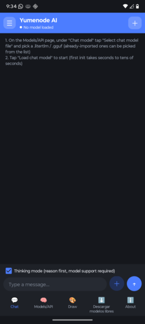
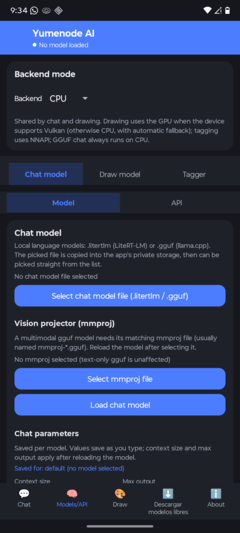
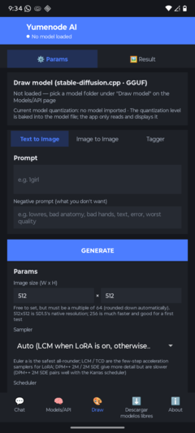
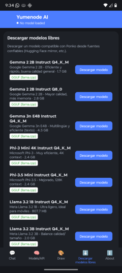
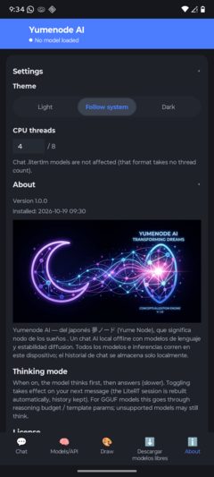

# Yumenode AI

     

> **Yumenode AI** — "Yume" (夢, *sueño*) + "Nodo" (*node*). Una aplicación Android que combina la magia de los sueños con la potencia de la inteligencia artificial. Totalmente offline, sin telemetría automática y sin cuenta: la app nunca envía datos por sí sola. El único envío opcional es el benchmark que tú decides compartir de forma anónima.

---

## 📖 Descripción Detallada

Yumenode AI es una **aplicación de IA offline completa** para Android que te permite:

- **Conversar** con modelos de lenguaje grandes (LLMs) directamente en tu dispositivo móvil.
- **Generar imágenes** desde texto o a partir de imágenes existentes usando modelos de difusión.
- **Etiquetar imágenes** automáticamente usando modelos ONNX offline.
- **Convertir tu móvil en un servidor API** compatible con OpenAI, para que otras máquinas usen tus modelos.

Todo sin necesidad de conexión a internet (excepto para descargar modelos manualmente). Tus conversaciones, chats e imágenes se almacenan de forma privada en el directorio interno de la app.

### 🔧 Características Principales

| Función | Descripción |
|---------|-------------|
| **Chat con IA** | Modelos `.litertlm` y `.gguf` con entrada multimodal (imagen, archivo, documento) |
| **Generación de imágenes** | Stable Diffusion (GGUF) con text-to-image, image-to-image, LCM-LoRA, TAESD |
| **Etiquetado automático** | Modelos ONNX (familia WD14) para extraer etiquetas de imágenes |
| **Servidor API** | Endpoints compatibles con OpenAI (`/v1/chat/completions`, `/v1/images/generations`, `/v1/models`) |
| **Streaming** | Salida token por token con renderizado Markdown en tiempo real |
| **Offline-first** | Sin telemetría automática ni cuenta; nada sale del dispositivo salvo lo que tú decidas |
| **Benchmark** | Mide tok/s, latencia y modelo cargado; resultado local con envío anónimo opcional |

### 📸 Capturas de Pantalla

Yumenode AI ofrece una interfaz de usuario limpia e intuitiva con varias pestañas funcionales:

<table>
  <tr>
    <td align="center"><br><b>Chat</b></td>
    <td align="center"><br><b>Models/API</b></td>
    <td align="center"><br><b>Draw</b></td>
  </tr>
  <tr>
    <td align="center"><br><b>Modelos libres</b></td>
    <td align="center"><br><b>Ajustes</b></td>
    <td align="center"></td>
  </tr>
</table>

**Chat**: Pantalla principal para conversaciones con IA. Permite cargar modelos `.litertlm` o `.gguf` y mantener conversaciones con entrada multimodal (texto, imágenes, archivos, documentos).

**Models/API**: Gestiona modelos locales y configuración del servidor API. Permite seleccionar backend (CPU/GPU), cargar archivos `.litertlm`/`.gguf`, configurar parámetros y exponer la app como un servidor OpenAI-compatible.

**Draw**: Configuración del modelo de dibujo (Stable Diffusion), selección de tipo/archivo `.gguf`, gestión de conjuntos multiarchivo, LoRA, TAESD y el botón de generar.

**Modelos libres**: Descarga modelos gratuitos desde fuentes confiables (mirrors de Hugging Face) directamente a la app.

**Ajustes**: Tema, idioma (Sistema / Inglés / Español), hilos de CPU, benchmark, endpoint personalizado e información de la app (versión, créditos, licencias y componentes de terceros).

### 🔄 Tipos de Workflow Soportados

Yumenode AI soporta varios flujos de trabajo integrados:

| Workflow | Herramientas Involucradas | Descripción |
|----------|---------------------------|-------------|
| **Chat → Imagen** | Chat model + Draw model | Si ambos modelos están cargados, di "dibuja..." y se invoca el generador de imágenes |
| **Chat → Tagger** | Chat model (sin visión) + Tagger | Un modelo de chat sin visión puede pedir prestado el Tagger para analizar imágenes. El modelo emite `<tag>`, la app etiqueta, y devuelve las etiquetas como resultado de herramienta |
| **Tagger → Imagen** | Tagger + Draw model | Extrae etiquetas de una imagen y reutilízalas como prompt para text-to-image o image-to-image |
| **Imagen → Imagen** | Draw model (img2img) | Usa una imagen de referencia con un "factor de ruido" (0.05~0.99) para restilizar, cambiar fondo o refinar |
| **Imagen → Chat** | Chat model + Image input | Carga hasta 4 imágenes y envíalas al modelo de chat (multimodal) |
| **API → Cliente remoto** | API Server | Expones el modelo cargado como API OpenAI-compatible; desde otro dispositivo usas `curl`, clientes de chat, etc. |

### 🧠 Tipos de Modelos Soportados

#### Modelos de Chat
| Formato | Runtime | Backend | Características |
|--------|---------|---------|-----------------|
| `.litertlm` | Google LiteRT-LM | CPU / GPU / NPU | Canal de razonamiento, entrada multimodal |
| `.gguf` | llama.cpp | CPU multihilo | Reutilización de caché KV, Q4/Q5/Q8, multi-gpu |

#### Modelos de Dibujo (Stable Diffusion)
| Formato | Familia | Notas |
|--------|---------|-------|
| `.gguf` | SD 1.5 | Single-file |
| `.gguf` | SDXL | Single-file (~2.5 GB) |
| `.gguf` | Flux | Multiarchivo |
| `.gguf` | SD 3 / 3.5 | Multiarchivo |
| `.gguf` | Qwen-Image | Multiarchivo |
| `.gguf` | HiDream | Multiarchivo |

#### Modelos de Etiquetado (Tagger)
| Formato | Familia | Notas |
|--------|---------|-------|
| `.onnx` | WD14 (Danbooru) | Necesita CSV de etiquetas emparejado |

#### Modelos Auxiliares
| Tipo | Extensión | Descripción |
|------|-----------|-------------|
| LoRA | `.safetensors` | Ajustes de rango bajo para Stable Diffusion |
| TAESD | `.safetensors` | Autoencoder diminuto para acelerar VAE |
| mmproj | `.gguf` / `.bin` | Proyección multimodal para chat GGUF visual |

### ⚙️ Parámetros de Inferencia

**Chat** (`.litertlm` y `.gguf`):
- Longitud de contexto
- Salida máxima (tokens)
- Temperatura, Top-K, Top-P
- Penalización de repetición
- Presupuesto de razonamiento
- Semilla

**Dibujo** (Stable Diffusion):
- Ancho / alto (múltiplo de 64)
- Pasos, guía (CFG), semilla
- Sampler (DPM++ 2M SDE / SDE B&T / LMS / Euler a / ...)
- Planificador
- Factor de ruido (img2img)

### 🌓 Temas

Tres modos de tema en **Ajustes → Tema**:
- **Brillante** — forzado
- **Oscuro** — forzado
- **Sistema** — sigue el tema del sistema

Los colores del UI incluyen: fondos, tarjetas, inputs, botones, diálogos, barra de estado y barra de navegación — todo sigue el tema sin reiniciar la app.

El idioma se cambia en **Ajustes → Idioma** (Sistema, Inglés o Español) y se aplica al instante, sin reiniciar y sin perder el modelo cargado.

### 🔬 Benchmark

En **Ajustes → Benchmark** puedes medir el rendimiento real del modelo de chat cargado: ejecuta generaciones cortas y muestra **tokens/segundo** (promedio, mínimo y máximo), latencia, modelo, backend y dispositivo. Todo se calcula y se muestra **en el dispositivo**.

**¿Es telemetría?** No. La app **no recopila ni envía nada automáticamente**. El benchmark es local y solo sale del teléfono si tú pulsas **"Compartir anónimamente"**, que envía únicamente: modelo, backend, dispositivo, SoC, versión, tok/s, latencia y número de tokens. **No se envían identificadores, IPs, prompts, imágenes ni archivos.**

Los resultados agregados son públicos en el dashboard: https://yumenode-bench.cjml555.workers.dev

El endpoint por defecto apunta a ese Worker; en Ajustes puedes pegar otro endpoint para enviar tus propias métricas o dejarlo sin usar.

---

## 📦 Instalación

### Desde el código fuente

```bash
./gradlew assembleRelease
# Output: app/build/outputs/apk/release/app-release-unsigned.apk
```

### Requisitos

| Dependencia | Versión |
|-------------|---------|
| JDK | 17 |
| compileSdk | 36 |
| minSdk | 28 |
| targetSdk | 36 |
| NDK | 27.3 |
| CMake | 3.31.6 |
| ABI | arm64-v8a (solo 64-bit ARM) |

### Firmar y publicar

Los scripts de firma están en `tools/`:

```bash
# Firmar con keystore (v1 + v2 + v3)
# Las contraseñas NO van en el script: lee keystore.properties (gitignored) o variable de entorno PONKO_KS_PASS
powershell -ExecutionPolicy Bypass -File tools/sign-apk.ps1 -Apk app\build\outputs\apk\release\app-release-unsigned.apk

# Build + sign + share + upload
powershell -File tools/build-release.ps1
```

---

## 📱 Guía Rápida

1. **Cargar un modelo de chat**: Abre "Modelos/API → Chat model → Model" y selecciona un archivo `.gguf` o `.litertlm`.
2. **Seleccionar backend**: Elige CPU o GPU (Vulkan) en "Modelos/API → Chat model → API".
3. **Configurar parámetros**: Ajusta temperatura, tokens, etc. — se guardan por modelo.
4. **Chat multimodal**: Toca "+", selecciona "Foto/Galería" (hasta 4 imágenes) y envía al chat.
5. **Cargar modelo de dibujo**: "Modelos/API → Draw model" → carga tu `.gguf`.
6. **Invocar dibujo desde chat**: Escribe "dibuja un gato" y se usará el modelo de dibujo cargado.
7. **Iniciar API Server**: "Modelos/API → Chat model → API" → "Start service" (puerto 8080, clave opcional).
8. **Usar API en otro dispositivo**:
   ```bash
   curl http://<IP-del-móvil>:8080/v1/chat/completions \
     -H "Content-Type: application/json" \
     -H "Authorization: Bearer TU_CLAVE" \
     -d '{"model":"gpt-4","messages":[{"role":"user","content":"Hola"}]}'
   ```

---

## 🧩 Limitaciones Conocidas

- El contexto de chat predeterminado es 4096 tokens (ajustable en la página de modelos).
- Chat `.gguf` es **solo CPU** (el binding no incluye GPU).
- El dibujo es CPU-only por defecto; GPU (Vulkan) no está validada en dispositivo real.
- El Tagger se carga bajo demanda (consume cientos de MB).
- Límite: 4 imágenes y 2 archivos por mensaje.
- Sin conexión: sin internet excepto descarga manual de modelos/LoRA y el envío opcional del benchmark.
- PDF escaneado (solo imagen) no extrae texto.

---

## 📄 Licencia

- **Código**: [MIT](LICENSE)
- **Iconos y assets visuales**: Proveídos por el usuario (SVG: `Yumanode_3bda4c.svg`)
- **Componentes de terceros**: Distribuidos bajo sus propias licencias (ver [NOTICE](NOTICE))

### Licencias de componentes clave

| Componente | Licencia |
|-----------|----------|
| Este proyecto (Yumenode AI) | MIT |
| stable-diffusion.cpp | MIT |
| ggml | MIT / Apache-2.0 |
| llama.cpp | MIT |
| LiteRT-LM | Apache-2.0 |
| ONNX Runtime | MIT |
| Markwon | Apache-2.0 |
| Kotlin / AndroidX | Apache-2.0 |
| Vulkan Headers | Apache-2.0 / MIT |
| LLVM libc++ (NDK) | Apache-2.0 with LLVM Exceptions |

---

## 🙏 Créditos

### Proyecto Original (Ponko)
- **Autor original**: [visitor257](https://github.com/visitor257) — Ponko app original (MIT License)
- **Repositorio original**: https://github.com/visitor257/Ponko

### Rebrand a Yumenode AI
- **Diseño de iconos y concepto**: Usuario (SVG: `Yumanode_3bda4c.svg`)
- **Implementación del rebrand**: [cjml555](https://github.com/cjml555)

### Componentes de Terceros
- **Google AI Edge** — LiteRT-LM
- **ggerganov** — llama.cpp, ggml
- **leejet** — stable-diffusion.cpp
- **Microsoft** — ONNX Runtime
- **noties** — Markwon
- **TomRoush** — PDFBox-Android
- **Khronos Group** — Vulkan-Hpp, Vulkan-Headers, SPIRV-Headers
- **Comunidad Kotlin y Android** — herramientas y librerías

> *Yumenode AI es un fork/rebrand de Ponko. Todos los componentes mantienen sus licencias originales.*